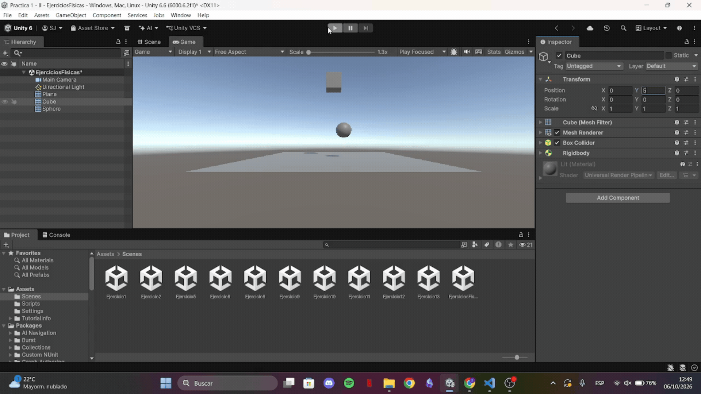
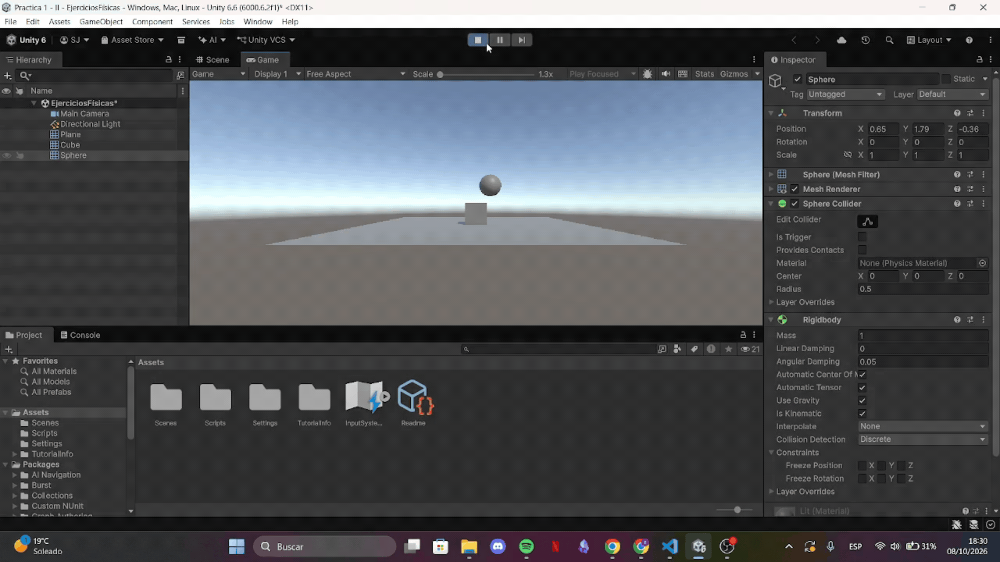
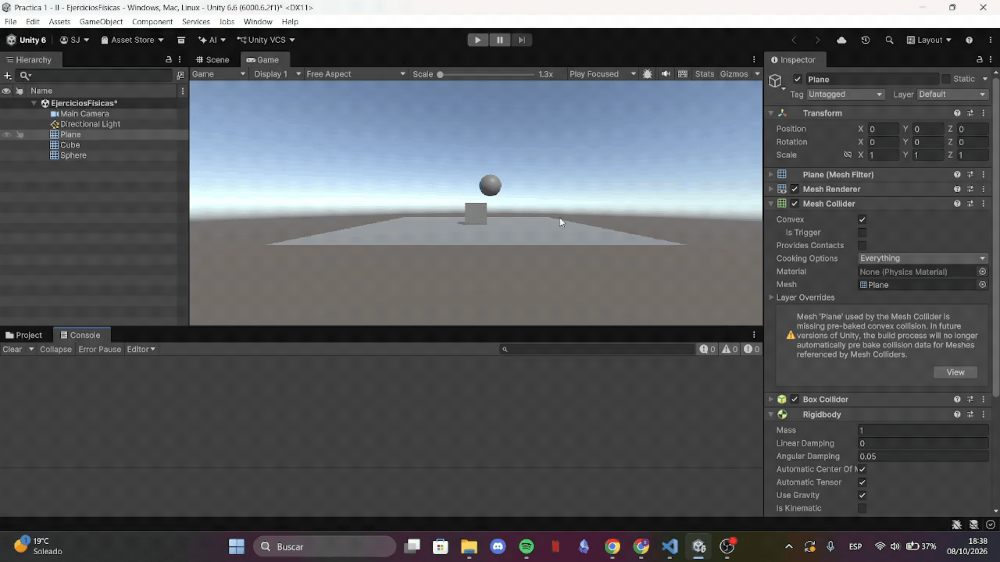
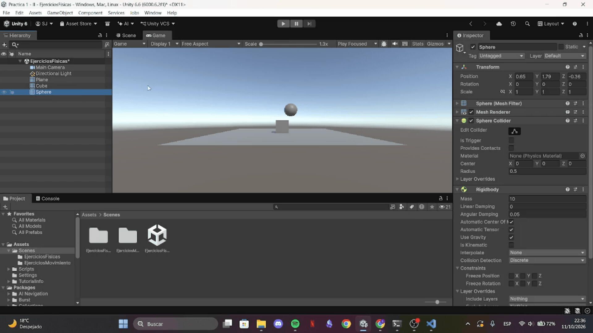
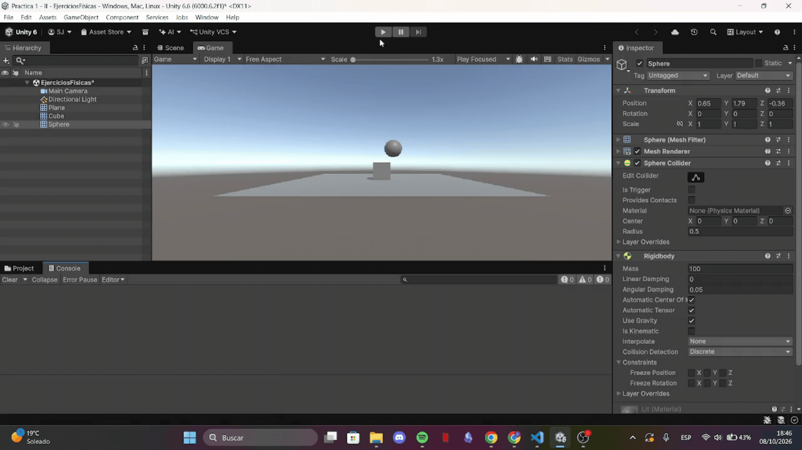
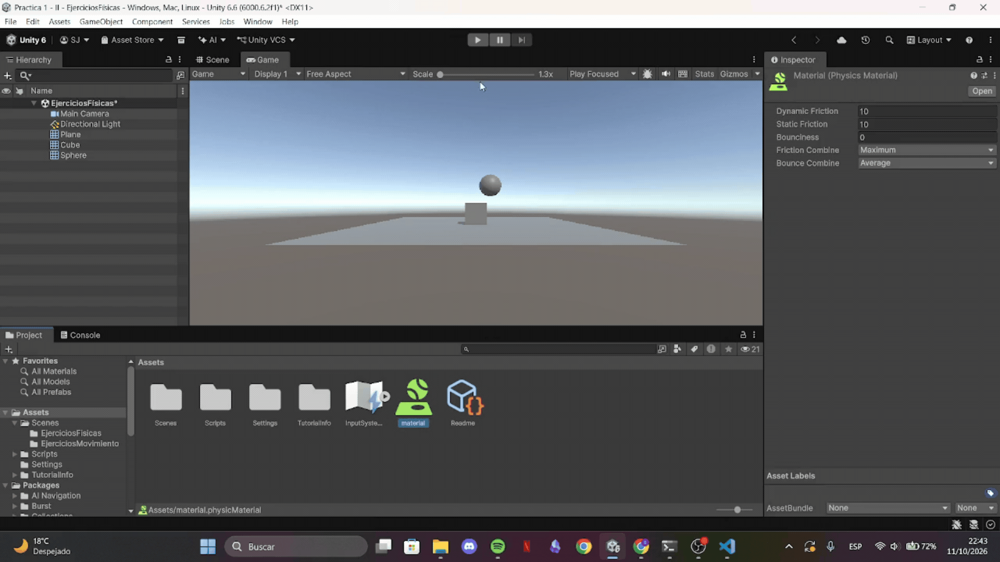
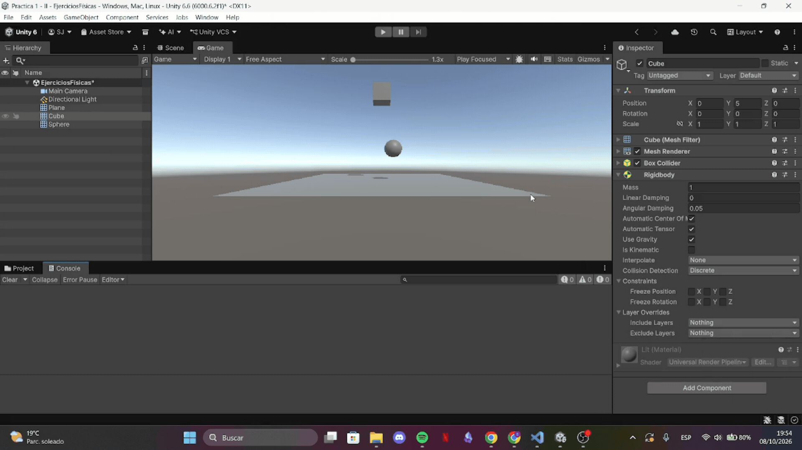
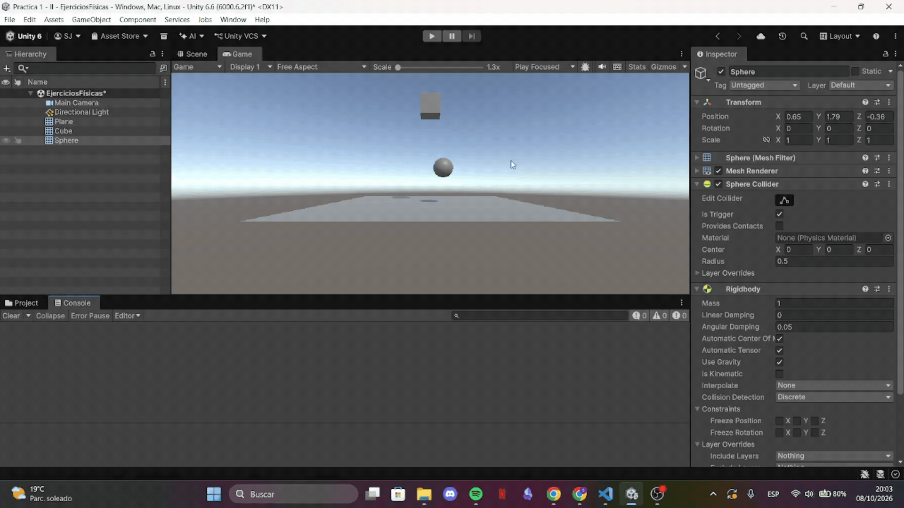

# Practica2 - II 
Práctica 2 de Interfaces Inteligentes

* **Autor:** Sonia Frías Jiménez 
* **ALU** alu0101492513@ull.edu.es
* **Versión de Unity:** 6.6

  
<b>Índice de ejercicios</b>

  1. [Ejercicios Físicas](#Ejercicios-de-Físicas)
  2. [Ejercicios Script](#Ejercicios-de-Script)

# Ejercicios de Físicas
## Situación 1
En esta situación el cubo cae por la gravedad chocando con la esfera en el proceso. Se debe a que el cubo es un dynamic collider mientras que la esfera y el plano son static collider.

Para visualizarlo he utilizado y=5 para el cubo en lugar de y=0.5 como pide al principio del enunciado.

## Situación 2
En esta situación la esfera también tiene un `rigidbody`, por lo que también es dynamic collider y se ve afectada por la gravedad. Cuando el cubo y la esfera chocan ambas sufren la colisión.

## Situación 3
Ahora la esfera también es cinemática, será un kinematic collider, por lo que el motor de físicas no le afecta y visualmente se ve como la situación 1, pero internamente no es lo mismo.

## Situación 4
En este caso todos los GameObject de la escena son rigidbody, es decir, dynamic collider. Dado que no se especifica si la esfera sigue siendo cinemática, como en el ejercicio anterior, he considerado que no lo es. 

Todos son elementos físicos, se ven afectados por la gravedad y caen.

## Situación 5
Es el mismo caso que el anterior, pero aumentando la masa de la esfera. Dado que es caida libre, la aceleración debida a la gravedad es constante e independiente de la masa, por lo el tiempo de caída son los mismos y no hay diferencia visual.

## Situación 6
De nuevo se aumenta la masa de la esfera y visualmente no hay diferencias. 

## Situación 7
????

## Situación 8
Se pide que la esfera sea un static trigger collider, por lo que al interactuar con el cubo (dynamic collider), no se produce una colisión física y se atraviesan, se emiten los eventos de trigger correspondientes.

## Situación 9
En este caso la esfera es un dynamic trigger collider, por lo que se verá afectado por la gravedad. Al interactuar con el plano (kinematic collider) no se produce colisión y se emite el trigger. Por eso, la esfera atraviesa el plano y el cubo (dynamic collider) no lo hace.

# Ejercicios de Script
## Ejercicio 1

Ejercicio 1: Crea un personaje,controla su desplazamiento con las teclas WASD o las flechas, el movimiento debe realizarse usando un Rigidbody, pero manteniendo el control total.
