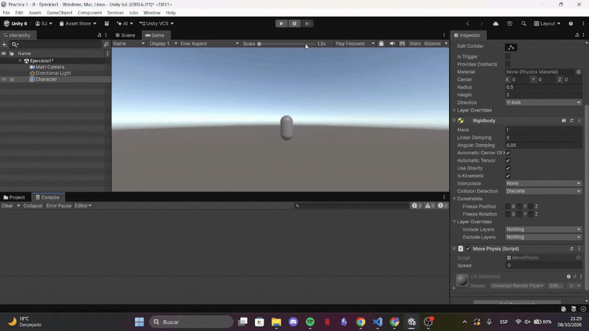
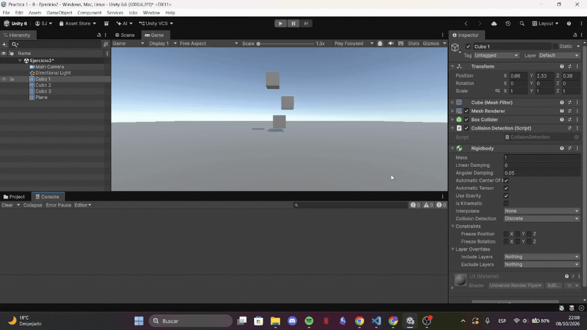
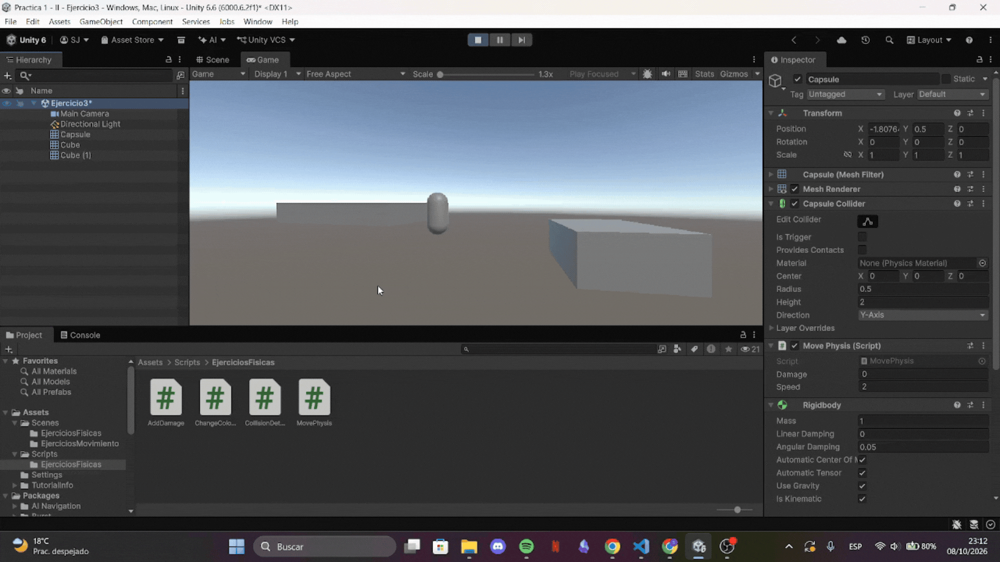
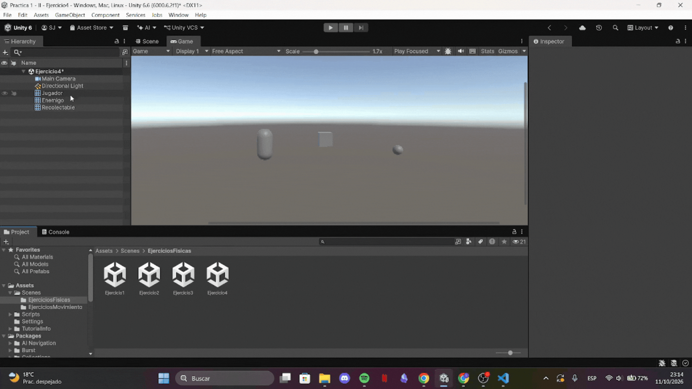
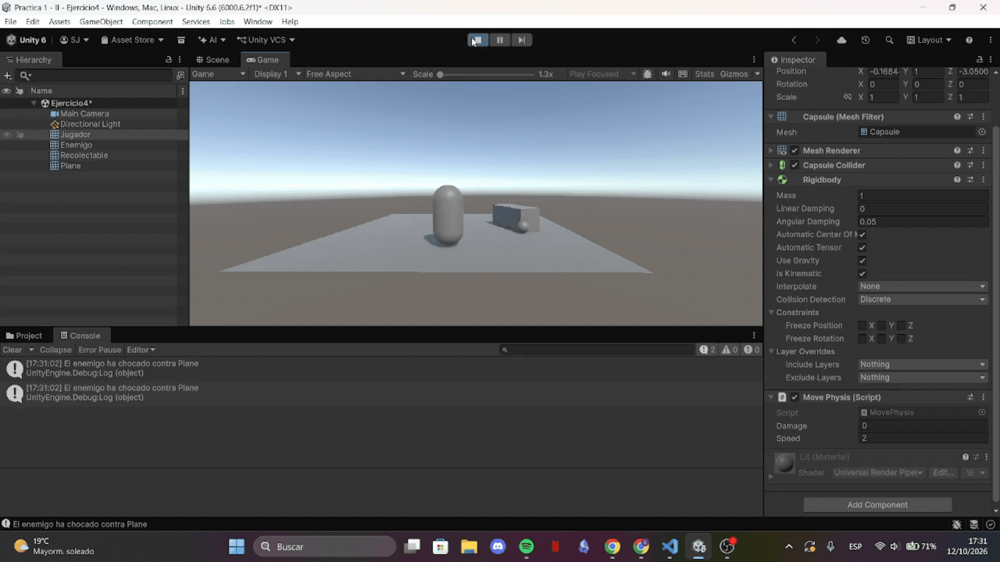
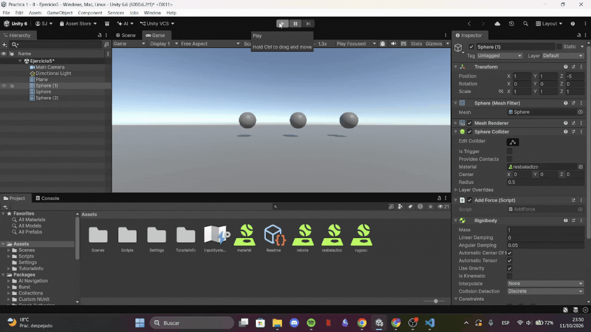
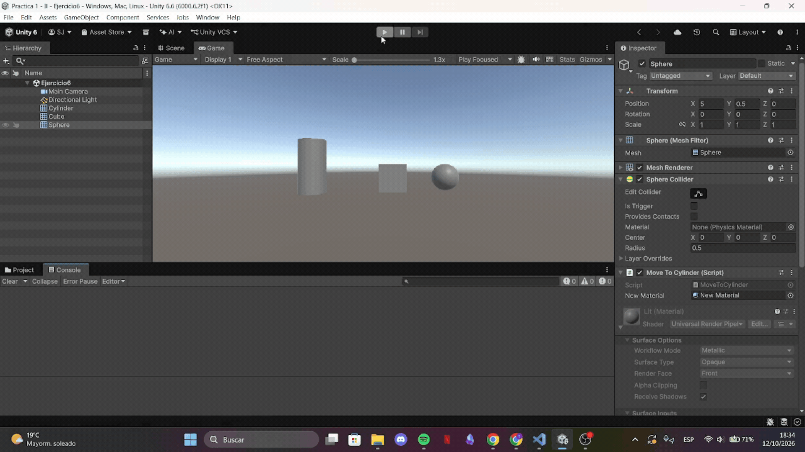

# Practica2 - II 
Práctica 2 de Interfaces Inteligentes

* **Autor:** Sonia Frías Jiménez 
* **ALU** alu0101492513@ull.edu.es
* **Versión de Unity:** 6.6

  
<b>Índice de ejercicios</b>

  1. [Ejercicios Físicas](#Ejercicios-de-Físicas)
  2. [Ejercicios Script](#Ejercicios-de-Script)

# Ejercicios de Físicas
## Situación 1
En esta situación el cubo cae por la gravedad chocando con la esfera en el proceso. Se debe a que el cubo es un dynamic collider mientras que la esfera y el plano son static collider.

Para visualizarlo he utilizado y=5 para el cubo en lugar de y=0.5 como pide al principio del enunciado.

## Situación 2
En esta situación la esfera también tiene un `rigidbody`, por lo que también es dynamic collider y se ve afectada por la gravedad. Cuando el cubo y la esfera chocan ambas sufren la colisión.

## Situación 3
Ahora la esfera también es cinemática, será un kinematic collider, por lo que el motor de físicas no le afecta y visualmente se ve como la situación 1, pero internamente no es lo mismo.

## Situación 4
En este caso todos los GameObject de la escena son rigidbody, es decir, dynamic collider. Dado que no se especifica si la esfera sigue siendo cinemática, como en el ejercicio anterior, he considerado que no lo es. 

Todos son elementos físicos, se ven afectados por la gravedad y caen.

## Situación 5
En este caso la esfera choca moviendo ligeramente al cubo

## Situación 6
De nuevo se aumenta la masa de la esfera, al chocar contra el cubo la fuerza es mayor. 

## Situación 7
Se le añade un material a la esfera para que tenga fricción

## Situación 8
Se pide que la esfera sea un static trigger collider, por lo que al interactuar con el cubo (dynamic collider), no se produce una colisión física y se atraviesan, se emiten los eventos de trigger correspondientes.

## Situación 9
En este caso la esfera es un dynamic trigger collider, por lo que se verá afectado por la gravedad. Al interactuar con el plano (kinematic collider) no se produce colisión y se emite el trigger. Por eso, la esfera atraviesa el plano y el cubo (dynamic collider) no lo hace.

# Ejercicios de Script
## Ejercicio 1
El ejercicio pide mover al personaje mediante rigidbody. Para ello creo un personaje, que va a ser un GameObject capsula y le añado un rigidbody kinetic para moverlo con libertad. 

Para realizar el movimiento utilizo el método `Rigidbody.MovePosition()` que recibe la posición exacta a la que se debe mover el personaje, esto implica que no sirve solo con calcular el vector de dirección:
1. Se calcula el vector dirección mediante GetAxis() y se normaliza
2. Se multiplica por la velocidad y Time.FixedDeltaTime para que el movimiento se ajuste al tiempo trascurrido realmente
3. Se llama a la función con el vector resultante de sumar la posición actual de rigidbody (no el de transform) y el desplazamiento total calculado arriba.

Añadí un atributo de velocidad para probar el movimiento

### Prueba

## Ejercicio 2
Para este ejercicio creé 3 cubos colocados de forma apilada a diferentes alturas para que al iniciar el juego caigan colisionando entre ellos. Todos los cubos tienen un dynamic collider y coloqué un plano static collider para que no cayeran al vacio por la gravedad.

El código está escrito en la función `OnCollisionEnter()`

### Prueba

## Ejercicio 3
Se pide crear dos zonas mediante trigger colliders.

1. Una de ellas debe cambiar el color del objeto con el que detecta la interación en el momento de entrada y reestablecerlo en la salida. Para ello utilizo `OnTriggerEnter()`, `OnTriggerExit()` y guardo en una variable el color previo al cambio para restaurarlo. 
Sin embargo, guardar solamente un color haría que si dos objetos entran en la zona antes de que el otro salga solo guardaría un color y al salir reestablecería el color incorrecto. Para evitarlo, guardo todos los renderes y colores en un diccionario.

2. El otro debe aumentar una variable daño mientras esté el objeto en la zona. Para ello añado una variable al objeto (en el script de movimiento) y la aumento desde `OnTriggerStay()`. Para que el daño no aumente de forma desproporcionada al tiempo transcurrido le añado `Time.FixedDeltaTime`

### Prueba

## Ejercicio 4

Para este ejercicio se crearon tres capas personalizadas en el proyecto: `Jugador`, `Enemigo` y `Recolectable`, asignando cada objeto de la escena a su capa correspondiente. El jugador cuenta con Collider y Rigidbody cinemático para interactuar con el entorno, el enemigo dispone de un Collider y Rigidbody y el recolectable tiene su Collider configurado en modo `Is Trigger` para permitir la detección por traspaso sin colisión física. 

En la **Layer Collision Matrix** (*Project Settings > Physics*), se filtraron las interacciones desmarcando todos los cruces innecesarios, de modo que los enemigos únicamente colisionen con el jugador y los recolectables solo interactúen con este a través de eventos de trigger.

Para ver que se cumple lo establecido en la matriz, creé unos scripts que imprimen un mensaje por consola cuando el enemigo y el recolectable detectan colisión. Como se puede observar en la prueba, cuando el jugador choca contra el enemigo se muestra un mensaje, pero cuando el enemigo atraviesa el recolectable no se muestra ningún mensaje.

### Prueba
Configuración

Prueba

## Ejercicio 5
En este ejecicio se crean 3 materiales ajustando su dynamic friction, static friction y bounciness para que sea resbaladizo, rugoso y que rebote. Vemos como al aplicarles una fuerza al pulsa la tecla X la esfera resbaladiza avanza más rápido pues no tiene resistencia que se le oponga mientras que que el rugoso tarda más. En el caso del material que rebota se observa como al caer por la gravedad rebota.

### Prueba

## Ejercicio 6
Se colocan en línea de tres elementos (Esfera, Cubo y Cilindro) que únicamente tienen Collider (sin componente Rigidbody). La esfera se desplaza hacia el cilindro y, al entrar en contacto con el cubo intermedio, altera el material visual de este último.

En el motor de físicas de Unity, dos Static Colliders no generan eventos OnCollisionEnter ni OnTriggerEnter entre sí, dado que las restricciones del enunciado incluyen no usar rigidbody hago lo siguiente:

1. La esfera calcula el vector de dirección horizontal hacia el cilindro mediante `(target - origin).normalized` y se desplaza usando `transform.Translate(..., Space.World)`.
2. En cada frame se evalúa la intersección espacial entre las cajas delimitadoras de ambos colliders mediante `cubeCollider.bounds.Intersects(sphereCollider.bounds)`
3. Si intersectan, se accede al componente `Renderer` del cubo y se le asigna el nuevo material visual.

### Prueba

